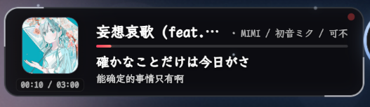
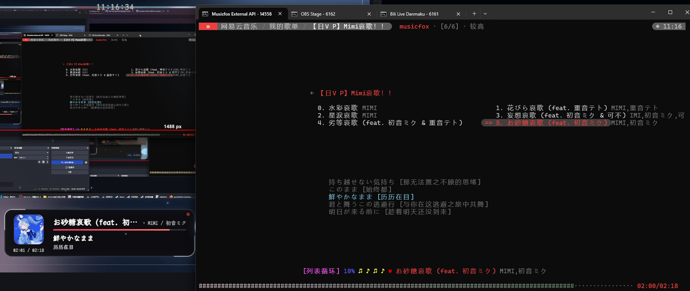
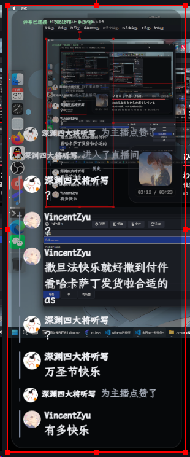
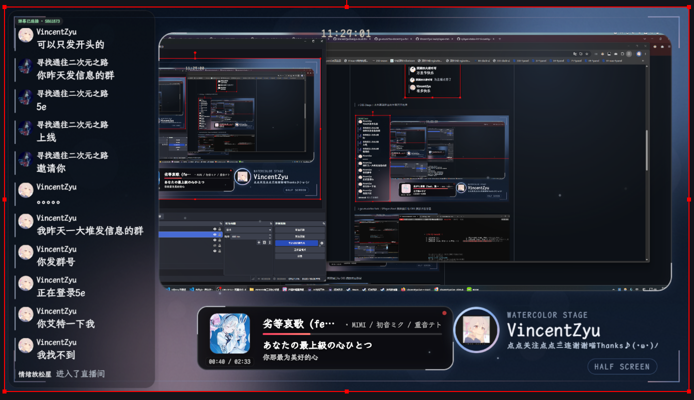

  

# VincentZyuLive

 [← 点我跳转](https://live.bilibili.com/5861873)  
 [← 点我跳转](https://vincentzyulive.github.io/VincentZyu233-OBS-stage/)  
 [← 点我跳转](https://github.com/VincentZyuLive)

> [!TIP]
> 这里收录 VincentZyu 的直播环境、弹幕、舞台与音乐工具，项目以自用为主，实验性居多，会围绕实际直播需求持续调整；
> 欢迎体验，也欢迎通过 Issue 或 PR 一起完善。

## 直播工具

| 项目 | 用途 |
| --- | --- |
| [SPlayer Status HTML Overlay](https://github.com/VincentZyuLive/splayer-status-html-overlay-for-obs) | OBS 音乐播放器状态 HTML 浮层，展示封面、歌词与播放进度 |
| [go-musicfox fork](https://github.com/VincentZyuLive/go-musicfox-vincentzyu-fork) | VincentZyu 的 fork 版本，并增加 SPlayer-Next 兼容 HTTP/WS API |
| [Bili Live Danmaku](https://github.com/VincentZyuLive/bili-live-danmaku) | B站透明弹幕 OBS 浮层，支持礼物、SC、历史、字体和 Edge TTS |
| [OBS Stage](https://github.com/VincentZyuLive/VincentZyu233-OBS-stage) | 水色雾蓝 OBS 舞台、开洞布局和 OBS WebSocket 管理 |

> ↓ SPlayer Status HTML Overlay：封面、歌词、进度条与播放控制浮层

> ↓ go-musicfox fork：SPlayer-Next 兼容接口与 OBS 播放状态浮层

> ↓ Bili Live Danmaku：透明弹幕与礼物、SC 展示

  

> ↓ OBS Stage：水色雾蓝舞台与半屏开洞布局

